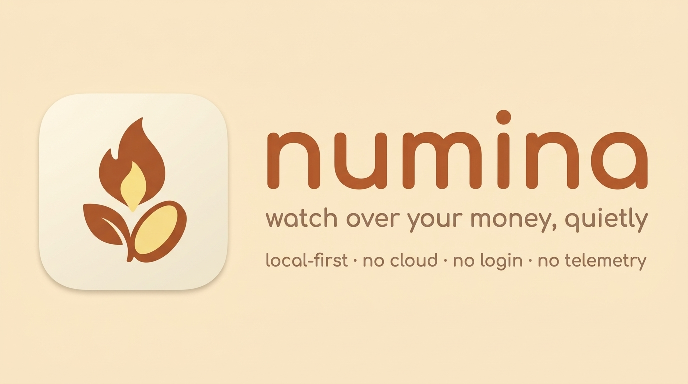
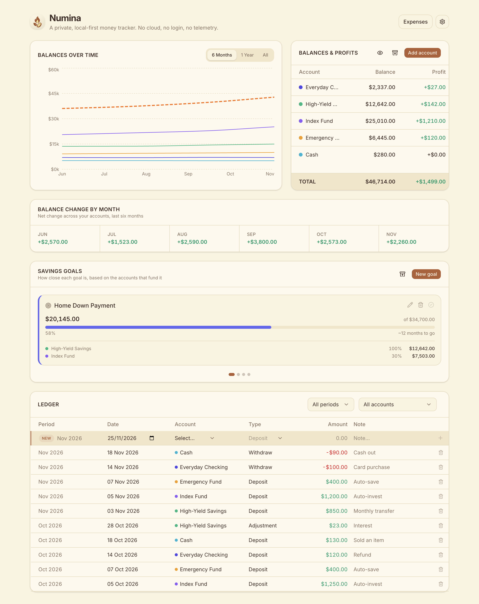
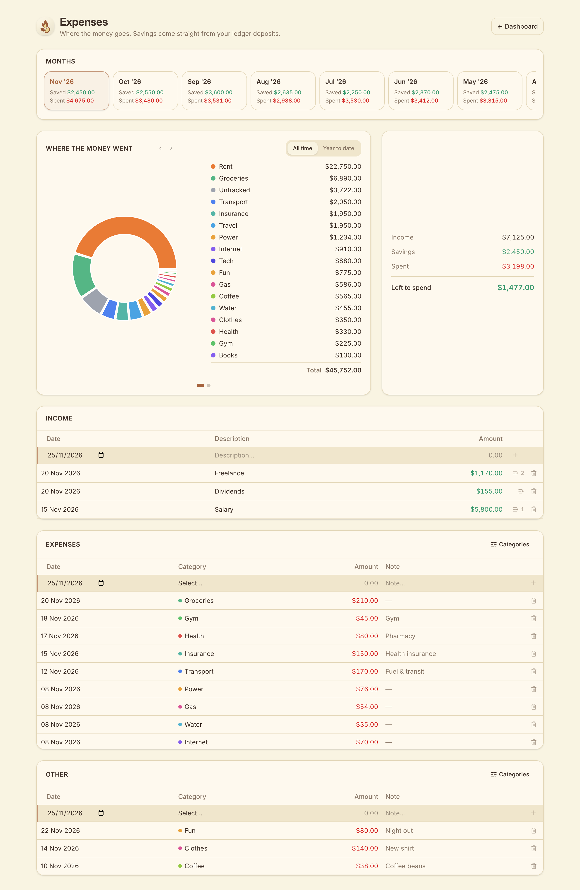

<div align="center">
  
  <h1>Numina</h1>
  <p><code>local-first</code>&nbsp;&nbsp;·&nbsp;&nbsp;<code>no cloud</code>&nbsp;&nbsp;·&nbsp;&nbsp;<code>no login</code>&nbsp;&nbsp;·&nbsp;&nbsp;<code>no telemetry</code>&nbsp;&nbsp;·&nbsp;&nbsp;<code>SQLite</code></p>
  
</div>

---

Every cloud finance app makes the same offer: hand us your bank logins, your
balances, your habits - and we'll show you a dashboard. Your most private
number, total net worth, becomes a row in someone else's database.

**Numina is the opposite trade.** One SQLite file on your own machine. One
browser tab (or an optional desktop window). Nothing ever leaves the computer - there is no code path in the
app that *can* send it anywhere: the server is bound to loopback, the CSP
blocks outside connections, and there is no analytics library to disable.

Numbers you can check:
- **0** external network calls after install
- **1** file that is your entire ledger (`data/numina.db`)
- **Everything** hand-editable in an Excel-style grid

## What you get

- **A balance-over-time chart** per account - line or bar, last 6 months, 1 year, or all.
- **Balances & profits at a glance** - all-time profit rolls up from adjustments, not vibes.
- **An Excel-style editable ledger** - deposits, withdrawals, and adjustments as plain rows, editable right in the table.
- **A hide-balances toggle** - one click blanks every amount on screen before you pass your laptop over.
- **A display-currency setting** - a gear in the header lets you pick the symbol shown everywhere ($, €, £, …). Amounts stay stored as integer cents; the choice persists in your browser's localStorage.
- **A set-new-balance helper** - reconciled to a real statement number but don't know the movement? Enter the balance, Numina works out the adjustment.
- **An expenses page** - months at a glance (saved from your ledger deposits, spent from budget entries), a scrollable money-flow card with pagination dots (where the money went, and where it came from), and spreadsheet-style income / expense / other tables with your own categories. Income lines take **sub-incomes** too - dated line items like "sold shoes" that add to the line, which shows its default plus every sub-income and dates itself to the most recent one.
- **Savings goals** - set a target and fund it from one or more accounts, each at its own weight (100% of one, 20% of another). Cards show weighted progress and a rough time-to-goal from how much you've recently put in (deposits plus positive adjustments); edit a goal any time, complete it once it's fully funded (archived, and restorable), or delete it. Hide the card any time from the settings gear.

## Screenshots

**The dashboard** - balances over time, profits at a glance, this month's
change, savings goals, and the ledger you edit in place.



**The expenses page** - months at a glance, the money-flow card (where the
money went, and where it came from), and the income / expense / other tables.



## Prerequisites

One-time requirements before the install command will work:

- **Node.js 22.13+** — the pinned pnpm 11 needs Node 22.13 or newer to run,
  and Next.js 16 / better-sqlite3 13 both want a modern runtime. If no
  prebuilt binary matches your Node version, better-sqlite3 compiles from
  source: on macOS that needs the Xcode Command Line Tools
  (`xcode-select --install`); on Windows it needs Visual Studio Build Tools.
- **pnpm** — the package manager this project is pinned to
  (`packageManager` in `package.json`). If you have Node but not pnpm:
  `corepack enable` or `npm i -g pnpm`. If you've never run `pnpm setup`,
  step 3/3 of `numina install` will say so and tell you what to do.
- **Windows works too.** `numina install` drops a `numina.cmd` shim into
  pnpm's global bin dir (no Developer Mode or admin rights needed), and the
  app itself is platform-neutral. macOS and Linux get a symlink instead.
- **Rust toolchain** *(optional — only for the desktop app)* — install from
  <https://rustup.rs>. The web app never needs it; `numina install-app` will
  tell you if it's missing.

> **Heads up about the first install:** `pnpm numina install` *does* use
> the network — that's the dependency download, and it's the only time.
> After installation, the app makes zero network calls: the server is
> bound to loopback and there is no outbound code path.

## How to use

**One-time setup** — clone the repo, then from inside the project run:

```bash
pnpm numina install
```

That single command installs dependencies, builds the production bundle, and
symlinks the launcher into pnpm's global bin dir. From then on, from **any**
directory:

```bash
numina     # start Numina and open the browser tab
```

(If the just-installed command isn't found yet, open a new terminal window —
that's where the pnpm global bin dir gets sourced.)

The launcher always runs *this* project: its `data/` ledger and its loopback
binding travel with it no matter where you invoke it from. It serves the
production build when one exists; `numina dev` runs hot-reload dev mode
instead.

Then the daily rhythm:

1. **Add your accounts** - a savings account, a fund, whatever holds money. Give each a color.
2. **Log movements** - every deposit or withdrawal is a row in the ledger: date, account, type, amount, note.
3. **Reconcile** - when the bank says something different, use the set-new-balance helper and move on. Adjustments are entries too, so your history stays honest.
4. **Toggle privacy on** before someone leans over your shoulder.

The database is created automatically at `data/numina.db` on first run.
To back up: copy the file. To start over: delete it.

## Desktop app (optional)

Prefer an icon in Applications or the Start Menu over a terminal? Numina ships
an optional desktop shell that wraps the same local server in a native window
(Tauri, using the operating system's webview — no Chromium is bundled). The
window talks to `http://127.0.0.1:3000` exactly like a browser would, so the
loopback binding and the request guard still apply, and the shell makes no
network calls of its own. The ledger stays at `data/numina.db`.

```bash
numina install-app   # build + install the app (needs the Rust toolchain)
numina app           # launch it later — or just double-click the icon
```

If Rust isn't installed, `numina install-app` offers to install it once —
nothing is downloaded or installed without you typing `yes`.

The app bakes in the absolute path of this checkout, because it launches the
server from here. If you move or rename the repo, run `numina install-app`
again. See [desktop/README.md](desktop/README.md) for details.

## Tech

| Layer | Tech |
|-------|------|
| UI | Next.js (App Router) + React + Tailwind + shadcn/ui |
| Charts | Recharts |
| Storage | SQLite via `better-sqlite3`, file at `data/numina.db` |
| API | Next.js Route Handlers (`/api/accounts`, `/api/movements`, `/api/expenses/*`) |
| Validation | Zod on every write |
| Fonts | Inter, vendored as woff2 (`next/font/local`) — no font downloads, ever |

Design decisions that matter here:

- **Money is signed integer cents** (`amount_cents`) end to end. No floats, ever - signs are applied at write time (+ deposit, − withdrawal, adjustment as given).
- **All SQL is prepared and parameterized**, and lives in one module (`src/lib/db/queries.ts`).
- **The write path is guarded**: loopback host checks, origin check, Zod - even though it's "just a local app."

## Security posture

"Local" is not the same as "safe." A page on the internet can reach
`http://127.0.0.1:3000` from your browser - Numina assumes it will try:

1. **Loopback-only binding** - the server never listens on a network interface.
2. **Host allow-list** - `/api/*` requests must target `127.0.0.1`, `localhost`, or `[::1]` (defeats DNS-rebinding).
3. **Origin check** - writes (POST/PATCH/DELETE) must carry an `Origin` matching the request host (defeats cross-site strikes at your local server).
4. **Strict CSP** - no external scripts, styles, frames, or connections.
5. **Zod validation** on every write before it touches the database.

The optional desktop app changes none of this: it runs the same loopback
server, and its shell makes no outbound calls of its own.

## Scripts

| Command | Purpose |
|---------|---------|
| `numina install` (or `pnpm numina install`) | One-time setup: deps + production build + global `numina` command |
| `numina` (or `pnpm numina`) | Start the app (prod build if present, dev otherwise) + open the browser tab |
| `numina open` | Just open the browser tab (start it first) |
| `numina stop` | Stop the running instance |
| `numina build` | Run the production build (`next build`) |
| `numina dev` | Force dev mode (same as `pnpm dev`) |
| `numina install-app` | Build + install the optional desktop app (requires Rust) |
| `numina app` | Launch the installed desktop app |
| `pnpm dev` | Start dev server only, on http://127.0.0.1:3000 |
| `pnpm build` | Production build |
| `pnpm start` | Serve the production build (loopback only) |
| `pnpm lint` | ESLint |

## Contributing

Numina is open to contributors! See [CONTRIBUTING.md](CONTRIBUTING.md) for
setup, the codebase rules, and how to open a pull request. Bug reports are
welcome too — please use the issue templates and **never attach your real
ledger file or unmasked screenshots**.

## License

MIT

---

<div align="center">
  <sub><strong>Numina</strong> - from Latin: the divine presence said to inhabit a place.
  Your money lives here. No one else needs to know.</sub>
</div>
