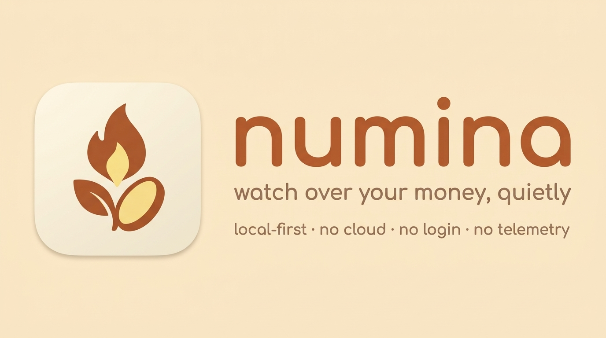

<div align="center">
  
  <h1>Numina</h1>
  <p><code>local-first</code>&nbsp;&nbsp;·&nbsp;&nbsp;<code>no cloud</code>&nbsp;&nbsp;·&nbsp;&nbsp;<code>no login</code>&nbsp;&nbsp;·&nbsp;&nbsp;<code>no telemetry</code>&nbsp;&nbsp;·&nbsp;&nbsp;<code>SQLite</code></p>
  
</div>

---

Every cloud finance app makes the same offer: hand us your bank logins, your
balances, your habits - and we'll show you a dashboard. Your most private
number, total net worth, becomes a row in someone else's database.

**Numina is the opposite trade.** One SQLite file on your own machine. One
browser tab. Nothing ever leaves the computer - there is no code path in the
app that *can* send it anywhere: the server is bound to loopback, the CSP
blocks outside connections, and there is no analytics library to disable.

Numbers you can check:
- **0** external network calls after install
- **1** file that is your entire ledger (`data/numina.db`)
- **Everything** hand-editable in an Excel-style grid

## What you get

- **A balance-over-time chart** per account - line or bar, last 6 months, 1 year, or all.
- **Balances & profits at a glance** - all-time profit rolls up from adjustments, not vibes.
- **An Excel-style editable ledger** - deposits, withdrawals, and adjustments as plain rows, editable right in the table.
- **A hide-balances toggle** - one click blanks every amount on screen before you pass your laptop over.
- **A set-new-balance helper** - reconciled to a real statement number but don't know the movement? Enter the balance, Numina works out the adjustment.

## How to use

```bash
pnpm install
pnpm numina     # starts the app and opens the browser tab for you
```

Then the daily rhythm:

1. **Add your accounts** - a savings account, a fund, whatever holds money. Give each a color.
2. **Log movements** - every deposit or withdrawal is a row in the ledger: date, account, type, amount, note.
3. **Reconcile** - when the bank says something different, use the set-new-balance helper and move on. Adjustments are entries too, so your history stays honest.
4. **Toggle privacy on** before someone leans over your shoulder.

The database is created automatically at `data/numina.db` on first run.
To back up: copy the file. To start over: delete it.

## Tech

| Layer | Tech |
|-------|------|
| UI | Next.js (App Router) + React + Tailwind + shadcn/ui |
| Charts | Recharts |
| Storage | SQLite via `better-sqlite3`, file at `data/numina.db` |
| API | Next.js Route Handlers (`/api/accounts`, `/api/movements`) |
| Validation | Zod on every write |
| Fonts | next/font, self-hosted at build time |

Design decisions that matter here:

- **Money is signed integer cents** (`amount_cents`) end to end. No floats, ever - signs are applied at write time (+ deposit, − withdrawal, adjustment as given).
- **All SQL is prepared and parameterized**, and lives in one module (`src/lib/db/queries.ts`).
- **The write path is guarded**: loopback host checks, origin check, Zod - even though it's "just a local app."

## Security posture

"Local" is not the same as "safe." A page on the internet can reach
`http://127.0.0.1:3000` from your browser - Numina assumes it will try:

1. **Loopback-only binding** - the server never listens on a network interface.
2. **Host allow-list** - `/api/*` requests must target `127.0.0.1`, `localhost`, or `[::1]` (defeats DNS-rebinding).
3. **Origin check** - writes (POST/PATCH/DELETE) must carry an `Origin` matching the request host (defeats cross-site strikes at your local server).
4. **Strict CSP** - no external scripts, styles, frames, or connections.
5. **Zod validation** on every write before it touches the database.

## Scripts

| Command | Purpose |
|---------|---------|
| `pnpm numina` | Start dev server + open the browser tab |
| `pnpm dev` | Start dev server only, on http://127.0.0.1:3000 |
| `pnpm build` | Production build |
| `pnpm start` | Serve the production build (loopback only) |
| `pnpm lint` | ESLint |

## License

MIT

---

<div align="center">
  <sub><strong>Numina</strong> - from Latin: the divine presence said to inhabit a place.
  Your money lives here. No one else needs to know.</sub>
</div>
